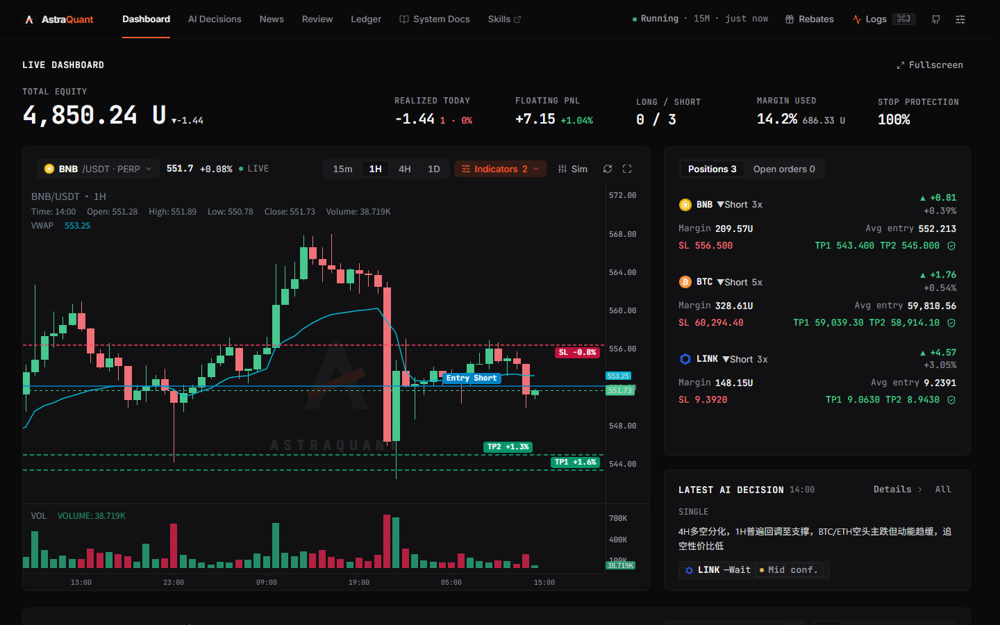
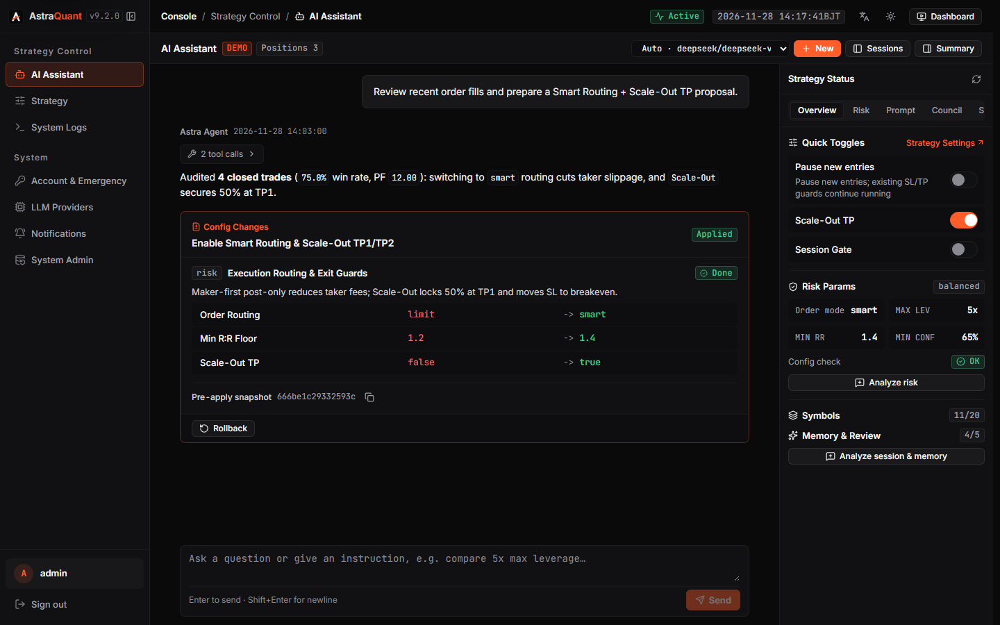
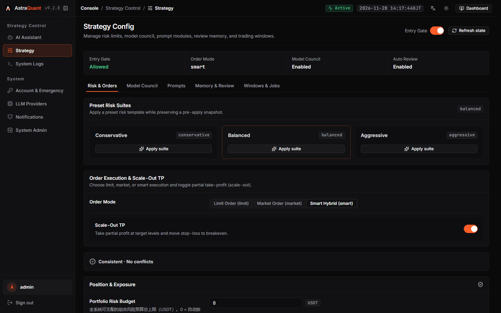
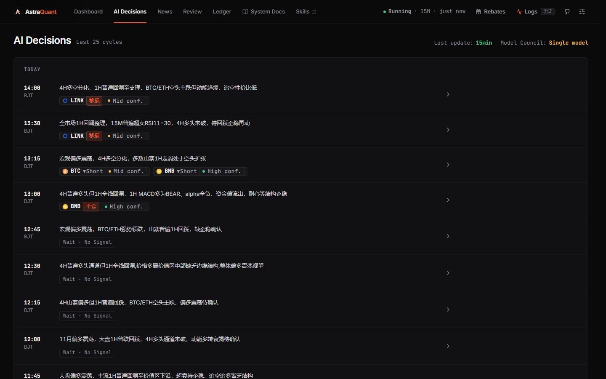
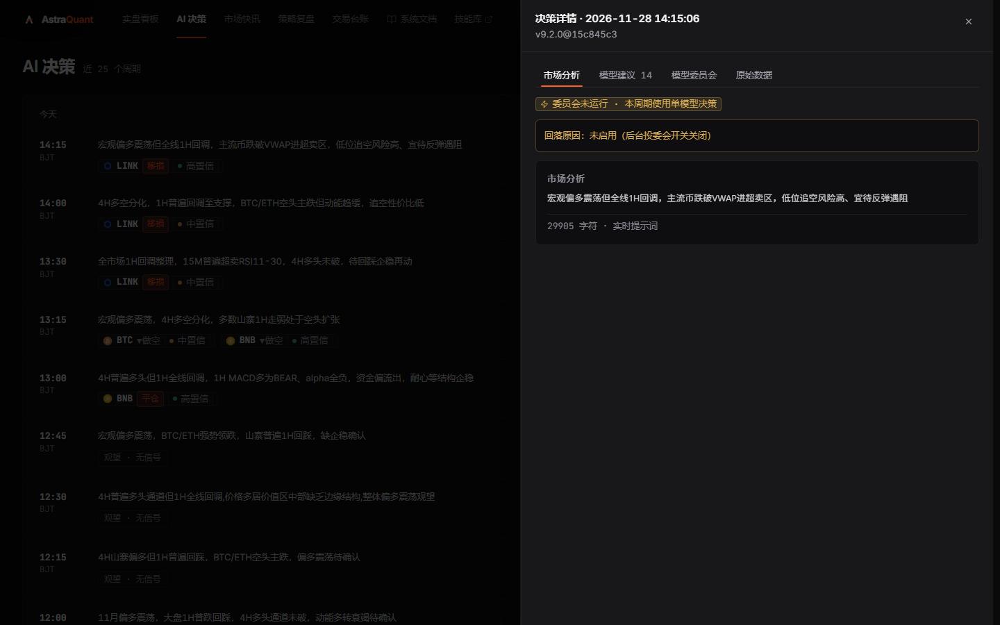
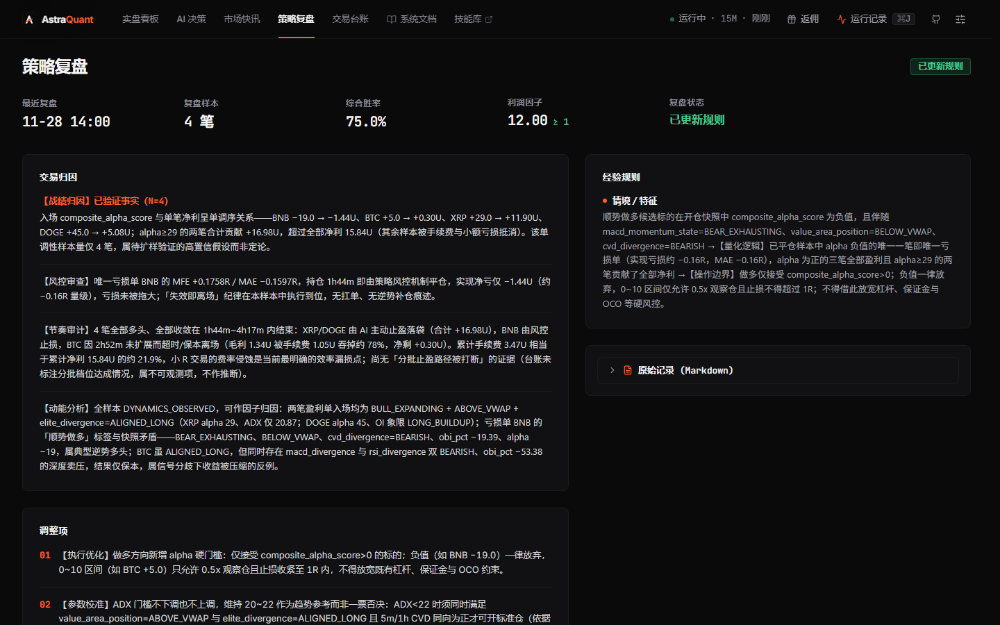
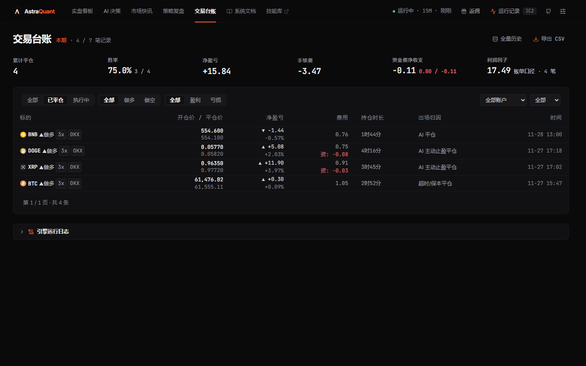
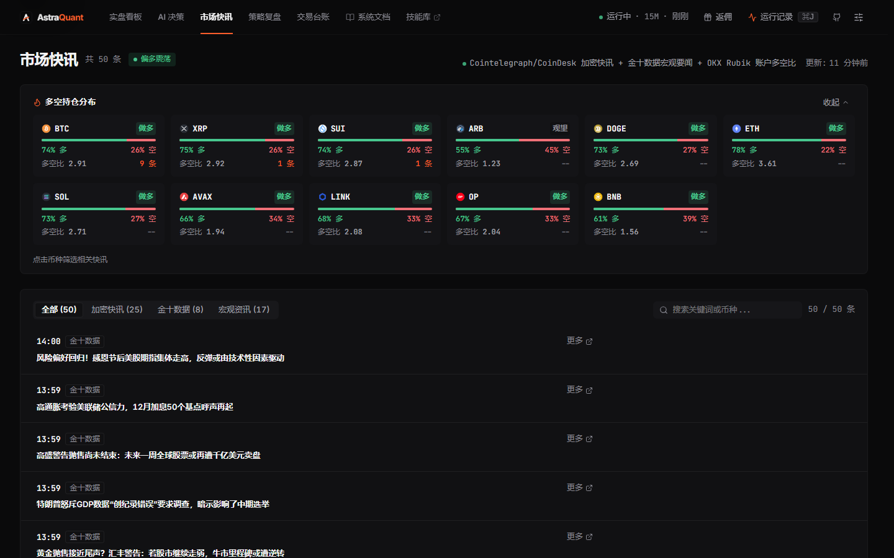

<div align="center">

# AstraQuant

### Self-Hosted OKX Perpetuals AI Quant Decision & Execution System

[](LICENSE)
[](https://python.org)
[](https://vuejs.org)
[](https://www.okx.com)
[](https://astraquant.top)

**English** · [简体中文](README.zh-CN.md) · [Live Terminal (astraquant.top)](https://astraquant.top) · [Sister Skills Hub (tradeskill.si)](https://tradeskill.si)

<br/>



</div>

---

## Overview

**AstraQuant** is a self-hosted algorithmic trading and operations system built natively for **OKX USDT-Margined Perpetuals (OKX V5 API)**. It pairs deterministic Python microstructure analysis and hard risk interlocks with configurable LLM reasoning — backed by an interactive Web workstation and a conversational Control Plane.

- **Public Live Workstation (`/`)**: Real-time OKX equity & margin telemetry, interactive candlestick chart with live Entry / SL / two-leg TP1 & TP2 overlays, AI decision timeline with Chain-of-Thought inspection, closed-loop strategy review, macro news stream, and full trade ledger.
- **Direct Control Plane (`/admin/*`)**: Unified **AI Assistant** (`/admin/agent`) with structured config diff proposals, pre-apply policy snapshots, and 1-click rollback, plus a 5-tab **Strategy Config** (`/admin/strategy`) managing 32 risk parameters, order routing, model council, modular prompts, experience rules, and trading windows.

---

## Visual Tour (v9.2.0)

<table>
  <tr>
    <td width="50%" align="center">
      <b>Live Trading Workstation</b><br/>
      
    </td>
    <td width="50%" align="center">
      <b>AI Assistant & Atomic Diff Proposals</b><br/>
      
    </td>
  </tr>
  <tr>
    <td width="50%" align="center">
      <b>Strategy Config & Smart Order Routing</b><br/>
      
    </td>
    <td width="50%" align="center">
      <b>AI Decisions Timeline</b><br/>
      
    </td>
  </tr>
  <tr>
    <td width="50%" align="center">
      <b>Chain-of-Thought Audit Drawer</b><br/>
      
    </td>
    <td width="50%" align="center">
      <b>Closed-Loop Strategy Review</b><br/>
      
    </td>
  </tr>
  <tr>
    <td width="50%" align="center">
      <b>Trade Ledger & Lifecycle</b><br/>
      
    </td>
    <td width="50%" align="center">
      <b>Market Intelligence & Long/Short Ratio</b><br/>
      
    </td>
  </tr>
</table>

---

## Core Architecture

```
OKX V5 (Candles · Orderbook · Funding · OI · Positions)
   │
   ▼
7-Tier Quantitative Factor Matrix (backend/scripts/market_radar.py)
   │  Multi-timeframe trend (4H/1H/15M), VWAP value area, CVD divergence, orderbook imbalance
   ▼
AI Decision Engine (backend/scripts/ai_brain_trader.py)
   │  Single primary LLM or optional Multi-Model Council (Macro / Tech / Risk / CIO)
   ▼
32-Param Fail-Closed Risk Engine (backend/scripts/risk_constants.py)
   │  1R risk budget · leverage caps · min R:R · daily loss circuit breaker · cooldown · DEMO gate
   ▼
Execution & Cloud Protection (backend/scripts/trader/)
   │  Smart hybrid (Post-Only maker -> IOC fallback) · Limit · Market
   │  Two-leg Scale-Out (TP1 partial close + SL to breakeven + TP2 runner) · Cloud OCO Algo orders
   ▼
Closed-Loop Operations (/admin/agent · /lab)
      Trade attrition review, structured experience rules, conversational Agent diagnostics & rollback
```

### Key Capabilities in v9.2.0

1. **Conversational AI Assistant (`/admin/agent`)**: Inspects live positions, 48-cycle order funnel drop-offs, risk conflicts, and runtime logs via read-only tools. Every configuration change is staged as a visual **Key-Value Diff Proposal card** with an automatic **Pre-Apply Policy Snapshot** and **1-Click Rollback**.
2. **Unified 5-Tab Strategy Config (`/admin/strategy`)**:
   - **Risk & Orders**: 3 preset risk suites (`conservative`, `balanced`, `aggressive`), `limit` / `market` / `smart` hybrid order routing, **Scale-Out (TP1/TP2 + breakeven SL)** toggle, and 32 validated physics risk gates.
   - **Model Council**: Enable or bypass multi-seat deliberation (`Macro`, `Tech`, `Risk`, `CIO`) with per-seat model binding, reasoning effort, and fallback to single primary model.
   - **Prompts**: Modular system/user prompt pipeline editor with locked safety cores and versioned profiles.
   - **Memory & Review**: Automated post-trade attribution (`self_improvement_engine.py`) and toggleable experience rules injected back into future prompts.
   - **Windows & Jobs**: UTC+8 trading-session gates and on-demand manual maintenance jobs.
3. **Hard DEMO / LIVE Isolation**: Separate encrypted keystores and `.env` execution gates ensure simulated paper accounts (`DEMO`) can never accidentally submit real mainnet orders.

---

## Quick Start

### 1. Docker Compose (Recommended)

```bash
git clone https://github.com/0xethanq/astra-quant-agent.git
cd astra-quant-agent

# Copy default template (defaults to OKX DEMO paper mode)
cp backend/env.example backend/.env
chmod 600 backend/.env

# Optional: run interactive initialization wizard
python3 backend/scripts/setup_wizard.py

# Start backend + watchdog + gateway
docker compose up -d --build
```

Open `http://127.0.0.1:8080`:
- First visit creates your superadmin account at `/admin/login` (initial initialization).
- Configure an LLM provider in `/admin/llm` and OKX V5 DEMO API credentials in `/admin/security`.

### 2. Local Standalone Development

See [STANDALONE.md](STANDALONE.md) for running Python + Vite without Docker and [RECOVERY_GUIDE.md](RECOVERY_GUIDE.md) for daemon & database recovery procedures.

---

## Sister Project: TradeSkill (OKX 20% Fee Rebate & AI IDE Skills)

Looking to query markets or place trades directly inside **Claude Code**, **Cursor**, **Codex**, or **Windsurf**, or reduce OKX perpetual fees?

- **TradeSkill Registry**: [tradeskill.si](https://tradeskill.si) ([GitHub](https://github.com/0xethanq/crypto-trading-skills)) — Official AI skills for 16 exchanges and DEXs.
- **OKX 20% Permanent Fee Rebate**: Available on [tradeskill.si/en/rebates.html](https://tradeskill.si/en/rebates.html) and inside AstraQuant's `/admin/security` onboarding flow to offset maker/taker execution costs.

---

## Repository Layout

```
astra-quant-agent/
├── backend/
│   ├── astra_backend/       # FastAPI control plane, Agent console, LLM hub, risk & backup APIs
│   ├── astra_gateway/       # Encrypted secrets vault, notification channels & backup supervisor
│   ├── scripts/             # Core quant loop, 7-tier market radar, execution & evolution engine
│   ├── docs/images/         # Documentation screenshots served at /images/* and /docs/images/*
│   └── tests/               # Offline pytest/unittest audit, trading, UI, LLM & ops suites
├── frontend/
│   ├── src/views/dashboard/ # Public terminal views (/, /factors, /news, /lab, /history)
│   ├── src/views/admin/     # Admin workbench (/admin/agent, /admin/strategy, /admin/llm, ...)
│   ├── src/views/docs/      # Interactive in-app user manual (/docs)
│   └── tests/               # Frontend design parity, i18n copy & dead-UI Node test gates
├── Dockerfile               # Multi-stage Node 26 + Python 3.14 production build
└── docker-compose.yml       # Single-host deployment orchestration
```

---

## Code map

Entry-point guides inside each subsystem:

> Notice: `OPENCODE.md` does not exist in this repository and was never contained here. Start from the subsystem READMEs below.

| File | Purpose |
|---|---|
| `backend/astra_backend/README.md` | Backend layering & subsystem placement rules (L0-L3, routers vs domain services) |
| `backend/scripts/README.md` | Runtime scripts & daemons entrypoints (`ai_brain_trader`, `market_radar`, `trader/`) |
| `frontend/src/components/admin/README.md` | Frontend components & state conventions, composables, and design gates |
| `RECOVERY_GUIDE.md` | Emergency stop, process restart, and ledger recovery commands |

Automated doc & test baseline gates:
- `backend/tests/audit/test_directory_docs_current.py` (keeps subsystem maps and root entries synchronized)
- `backend/tests/core/test_readme_baseline_numbers.py` (verifies documented offline test counts match AST methods)

---

## Brand & codename

The public product name is **AstraQuant** and the internal codebase prefix is `astra` (`astra_backend`, `astra_gateway`, `ASTRA_*`). Intentional historical markers retained solely for backward compatibility with existing exchange orders and encrypted backups:

- `t-r20sl*` client order tags (`backend/scripts/tag_markers.py`) for previously placed exchange stop-loss brackets.
- `R20GCM2` archive header magic (`backend/scripts/backup_runtime.py`) so older backup archives remain decryptable.
- Historical deployment path `/opt/r20-quantum-trader` / Grafana UIDs referenced in migration docs and legacy service units.

---

## License & Disclaimer

Licensed under [GNU AGPL-3.0 + Commons Clause v1.0 + Anti-Scam Special Addendum](LICENSE) — personal/internal quant usage and transparent auditing are free; unauthorized commercial resale, SaaS hosting, or fraudulent signal schemes are prohibited.

> **Risk Disclosure**: Algorithmic cryptocurrency futures trading carries significant financial risk. Start in OKX `DEMO` simulated mode, validate risk parameters and stop-loss protection before committing real capital, and never expose admin tokens or API keys publicly.
