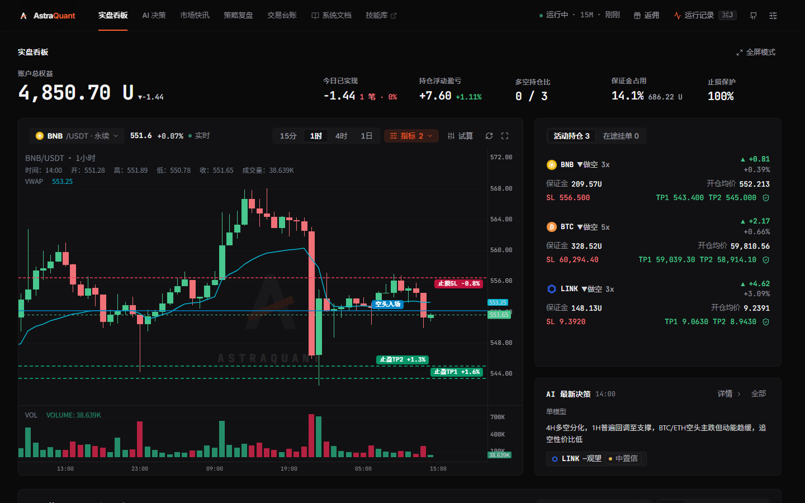
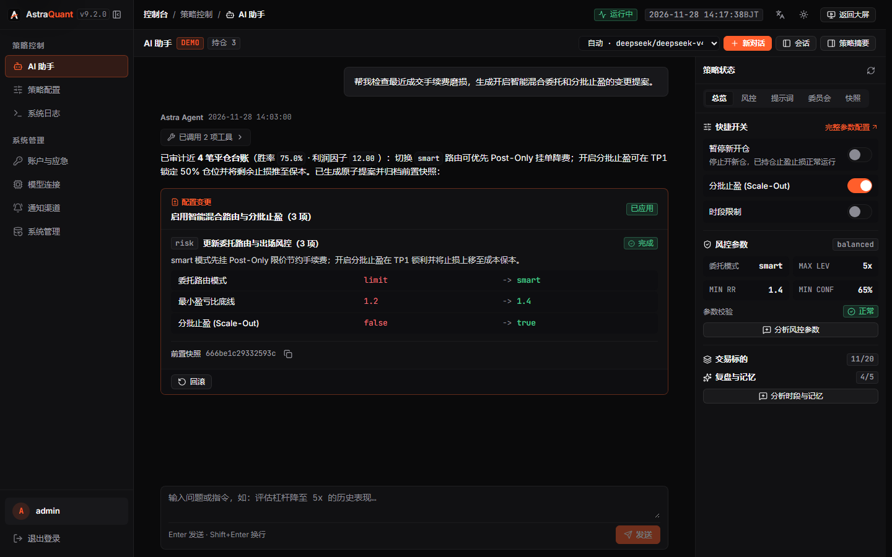
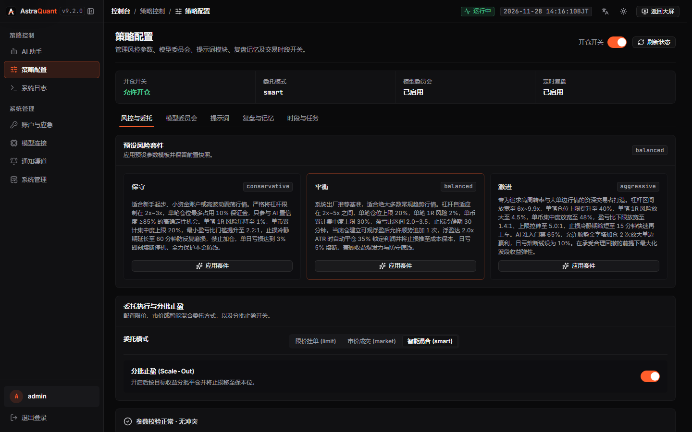
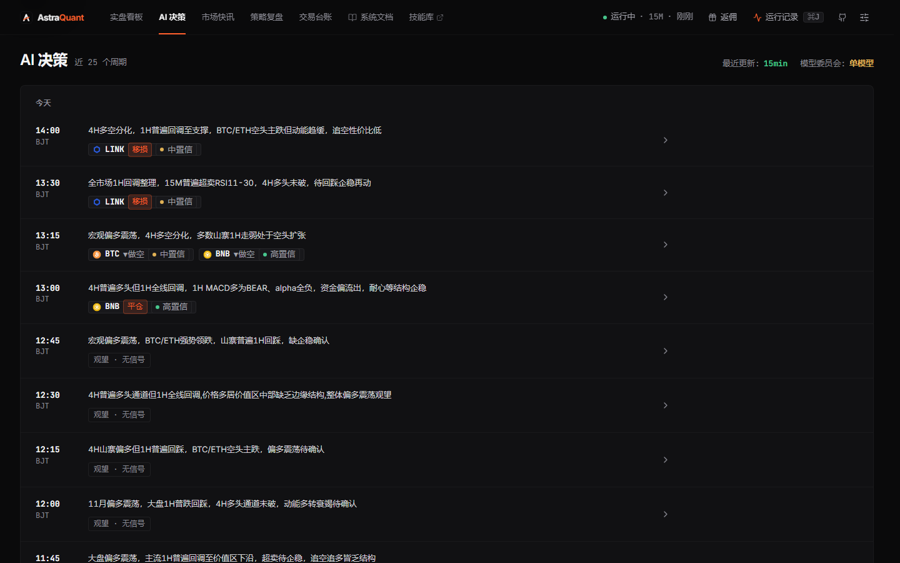
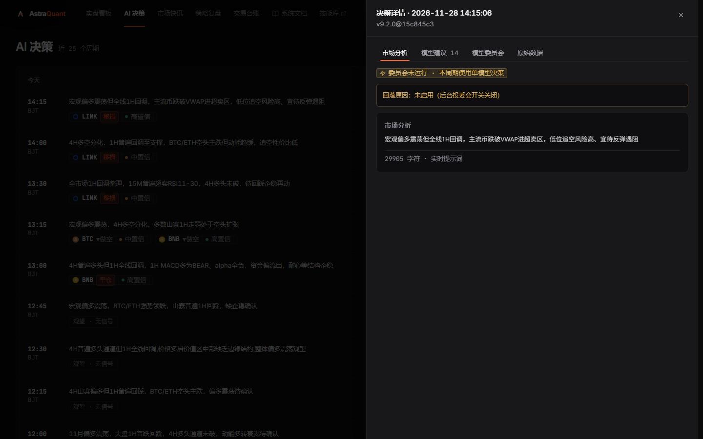
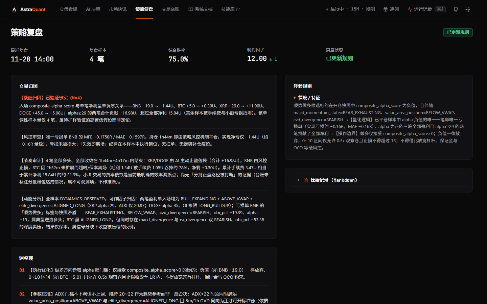
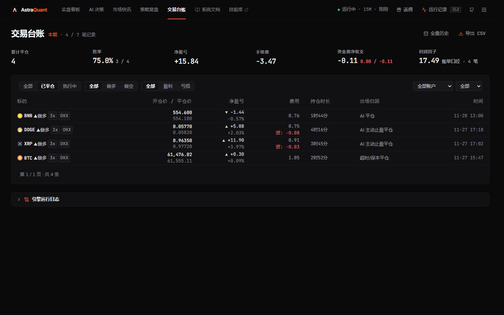
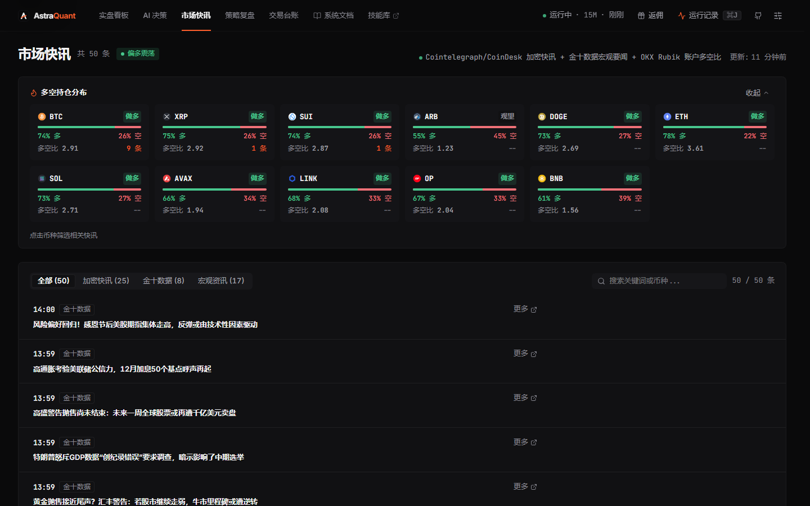

<div align="center">

# AstraQuant

### 面向 OKX 永续合约的自托管 AI 量化决策与执行系统

[](LICENSE)
[](https://python.org)
[](https://vuejs.org)
[](https://www.okx.com)
[](https://astraquant.top)

[English](README.md) · **简体中文** · [实盘看板演示 (astraquant.top)](https://astraquant.top) · [配套技能库 (tradeskill.si)](https://tradeskill.si)

<br/>



</div>

---

## 系统定位

**AstraQuant** 是一套专为 **OKX USDT 本位永续合约（OKX V5 API）** 打造的私有化 AI 量化决策与自动化执行终端。系统将 Python 量化微结构因子计算、刚性风控校验与大语言模型推理结合，提供完整的公开透明看板与后台控制面。

- **公开量化看板 (`/`)**：实时账户权益与保证金监控、带 Entry / SL / 两段式分批止盈（TP1 / TP2）标线的 K 线工作台、AI 决策周期流与思维链（CoT）审计抽屉、策略复盘归因、宏观快讯与全量平仓台账。
- **后台控制面 (`/admin/*`)**：内置 **AI 助手**（`/admin/agent`，支持只读诊断工具、结构化配置 Diff 提案审批、前置快照归档与一键回滚）以及 5 标签 **策略配置中心**（`/admin/strategy`，集中管控 32 项物理风控参数、智能混合委托、分批止盈、模型委员会、提示词工程与交易时段）。

---

## 界面总览 (v9.2.0)

<table>
  <tr>
    <td width="50%" align="center">
      <b>实盘量化工作台 (Signal Orange)</b><br/>
      
    </td>
    <td width="50%" align="center">
      <b>AI 助手与原子变更 Diff 提案</b><br/>
      
    </td>
  </tr>
  <tr>
    <td width="50%" align="center">
      <b>策略配置台与智能委托路由</b><br/>
      
    </td>
    <td width="50%" align="center">
      <b>AI 决策推演时序流</b><br/>
      
    </td>
  </tr>
  <tr>
    <td width="50%" align="center">
      <b>决策详情与思维链 (CoT) 抽屉</b><br/>
      
    </td>
    <td width="50%" align="center">
      <b>闭环策略复盘与经验规则</b><br/>
      
    </td>
  </tr>
  <tr>
    <td width="50%" align="center">
      <b>全量平仓台账与资金费率明细</b><br/>
      
    </td>
    <td width="50%" align="center">
      <b>宏观资讯与多空持仓情绪</b><br/>
      
    </td>
  </tr>
</table>

---

## 核心架构

```
OKX V5 行情与账户源（K 线 · 盘口深度 · 资金费率 · OI · 实时持仓）
   │
   ▼
7 梯队量化因子矩阵 (backend/scripts/market_radar.py)
   │  4H/1H/15M 多周期结构、VWAP 价值区间、CVD 背离、盘口失衡
   ▼
AI 决策引擎 (backend/scripts/ai_brain_trader.py)
   │  单主脑直出或可选多模型委员会（宏观 / 技术 / 风控 / CIO 终审）
   ▼
32 项 Fail-Closed 物理风控引擎 (backend/scripts/risk_constants.py)
   │  1R 风险预算 · 杠杆区间钳制 · 最小 R:R 门禁 · 日亏熔断 · 冷静期 · DEMO/LIVE 物理隔离
   ▼
执行与云端保护 (backend/scripts/trader/)
   │  智能混合路由 (smart: Post-Only 挂单 -> 超时 IOC 补齐) · 限价 · 市价
   │  两段式分批止盈 (TP1 锁利 + 止损移至保本 + TP2 追踪) · OKX 云端 OCO 条件单
   ▼
闭环运维控制面 (/admin/agent · /lab)
      战绩归因、经验规则提炼、对话式 Agent 诊断与快照一键回滚
```

### v9.2.0 核心特性

1. **对话式 AI 助手 (`/admin/agent`)**：通过只读工具直查实时持仓、近 48 周期开单漏斗拦截统计、风控参数冲突与系统日志；所有修改均以**结构化 Diff 提案卡片**呈现在对话中，确认后自动保存**前置策略快照**并支持**一键回滚**。
2. **5 标签策略配置中心 (`/admin/strategy`)**：
   - **风控与委托**：内置保守 / 平衡 / 激进 3 套风控模板，支持 `limit` / `market` / `smart` 智能混合委托路由、**分批止盈 (Scale-Out TP1/TP2)** 总开关与 32 项物理风控参数实时冲突审计。
   - **模型委员会**：可按需开启或关闭多席位协同评审，支持单席位模型独立绑定与故障自动降级至主脑单模型。
   - **提示词**：模块化 Prompt 组装引擎，核心风控边界锁定保护，支持多套方案一键切换。
   - **复盘与记忆**：平仓后自动运行归因复盘（`self_improvement_engine.py`），提炼规则经后台审核可开启注入后续决策。
   - **时段与任务**：支持 UTC+8 交易时段门禁控制及手动触发复盘/对账/备份任务。
3. **严格的 DEMO / LIVE 隔离**：模拟盘与实盘密钥分别加密存储，并受独立环境变量开闸门控，防止测试阶段误发实盘委托。

---

## 快速部署

### 1. Docker Compose 一键部署（推荐）

```bash
git clone https://github.com/0xethanq/astra-quant-agent.git
cd astra-quant-agent

# 生成默认配置文件（默认锁定为 OKX DEMO 模拟盘）
cp backend/env.example backend/.env
chmod 600 backend/.env

# 可选：运行交互式初始化向导
python3 backend/scripts/setup_wizard.py

# 构建并启动服务（自动拉起后端 API、行情雷达与通知网关）
docker compose up -d --build
```

启动后访问 `http://127.0.0.1:8080`：
- 首次访问 `/admin/login` 按指引设置超级管理员账号密码。
- 在 **模型连接**（`/admin/llm`）添加 API Key 并测试连通，在 **账户与应急**（`/admin/security`）填入 OKX V5 模拟盘三件套即可开始运行。

### 2. 本地源码开发与故障恢复

- 非 Docker 独立部署方式请参阅 [STANDALONE.md](STANDALONE.md)。
- 进程守护与紧急恢复命令请参阅 [RECOVERY_GUIDE.md](RECOVERY_GUIDE.md)。

---

## 姊妹项目：TradeSkill（AI IDE 交易技能库 & OKX 20% 返佣）

如果你需要在 **Claude Code**、**Cursor**、**Codex** 或 **Windsurf** 内直接交互式查盘或下单，欢迎配合使用同系列开源技能库：

- **TradeSkill 技能导航**：[tradeskill.si](https://tradeskill.si)（[GitHub](https://github.com/0xethanq/crypto-trading-skills)）—— 收录 16 家主流交易所与 DEX 的官方开源 Agent Skill。
- **OKX 永久 20% 手续费返佣**：可在 [tradeskill.si/rebates.html](https://tradeskill.si/rebates.html) 或 AstraQuant 后台接入引导中获取，降低自动化合约交易手续费磨损。

---

## 目录结构

```
astra-quant-agent/
├── backend/
│   ├── astra_backend/       # FastAPI 控制面、AI 助手引擎、风控/模型/备份路由
│   ├── astra_gateway/       # 密钥加密库、多通道通知网关与自动备份守护
│   ├── scripts/             # 交易主循环、7 梯队行情雷达、执行路由与自进化引擎
│   ├── docs/images/         # 系统文档与大屏截图资源（自动挂载至 /images/*）
│   └── tests/               # 离线单元测试与架构/安全/文档审计门禁
├── frontend/
│   ├── src/views/dashboard/ # 公开终端视图（/、/factors、/news、/lab、/history）
│   ├── src/views/admin/     # 后台工作台（/admin/agent、/admin/strategy、/admin/llm 等）
│   ├── src/views/docs/      # 应用内交互式系统文档（/docs）
│   └── tests/               # 前端样式、i18n 与死 UI 检查门禁
├── Dockerfile               # Node 26 + Python 3.14 多阶段构建配置
└── docker-compose.yml       # 单机容器编排配置
```

---

## 代码结构入口

各子系统职责分层与开发约定见下列入口文档：

> 注意：仓库中从未存在 `OPENCODE.md`，请勿按该文件名查找规则，请以下表三份文档为准。

| 文档路径 | 用途说明 |
|---|---|
| `backend/astra_backend/README.md` | 后端分层约定（L0 门面、L1 装配、L2 路由、L3 领域服务及新文件放置规则） |
| `backend/scripts/README.md` | 交易主循环、雷达与各个后台脚本中，哪个是入口/守护与运行态契约 |
| `frontend/src/components/admin/README.md` | 前端组件与状态管理、composables 复用及 UI 门禁约定 |
| `RECOVERY_GUIDE.md` | 紧急止损/停盘、服务重启与台账对账恢复指南 |

文档与基线校验门禁：
- `backend/tests/audit/test_directory_docs_current.py`（核对子系统文档表、守护入口与结构章节）
- `backend/tests/core/test_readme_baseline_numbers.py`（校验 README 中记录的测试基线例数）

---

## 品牌与内部代号

对外品牌统一为 **AstraQuant**，内部包名与环境变量前缀统一使用 `astra`（如 `astra_backend`、`astra_gateway`、`ASTRA_*`）。以下历史兼容记号为有意保留：

- `t-r20sl*`：交易所端历史存量保护挂单前缀识别符（`backend/scripts/tag_markers.py`）。
- `R20GCM2`：旧版备份归档解密魔数头（`backend/scripts/backup_runtime.py`），确保历史备份仍可恢复。
- `/opt/r20-quantum-trader` 及迁移文档中提及的旧部署路径与 Grafana UID 兼容性标识。

---

## 许可协议与风险提示

基于 [GNU AGPL-3.0 + Commons Clause v1.0 + Anti-Scam 特约附则](LICENSE) 开源发布：允许个人与内部研发免费私有部署和审计，禁止未经授权的商业售卖、托管转租及金融欺诈用途。

> **风险提示**：加密货币永续合约具有高波动与杠杆放大风险。建议始终先在 OKX `DEMO` 模拟盘验证风控参数与策略稳定性，妥善保管管理员密码、API 密钥与备份私钥，勿将任何敏感凭据提交至公共仓库。
